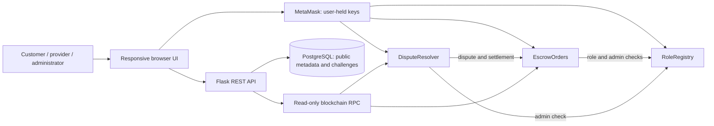
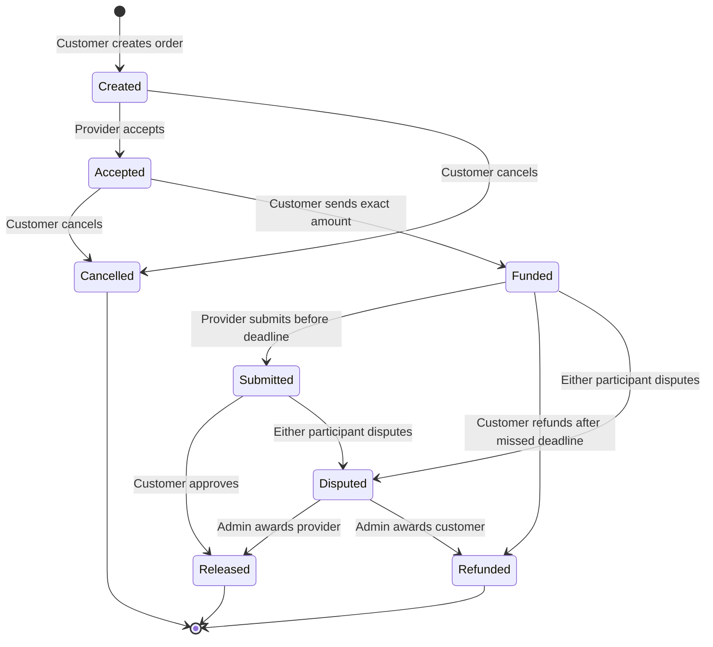

# Architecture and state model

Released and Refunded credit a withdrawable balance; they do not immediately send ETH. One withdrawal can collect credits from multiple orders. Exact financial invariant: contract balance is at least lockedTotal + claimableTotal. Equality normally holds; unsolicited forced ETH can make the balance larger.

## Data model

| Location | Record | Fields |
|---|---|---|
| RoleRegistry | roles[address] | None, Customer, Provider, Admin |
| EscrowOrders | orders[id] | customer, provider, amount in wei, deadline, state, terms hash, delivery hash |
| EscrowOrders | credits[address] | aggregate withdrawable wei |
| DisputeResolver | disputes[id] | openedBy, reasonHash, resolved, payProvider |
| On-chain logs | events | lifecycle actions, evidence hashes, rulings, withdrawals |
| Database | contents | digest primary key, author, canonical JSON, created time |
| Database | challenges | nonce primary key, address, message, expiry, attempts |

Canonical JSON contains kind, title, description and authenticated author. It is hashed with Keccak-256. Hashes give integrity when text is available; they do not prove truth or guarantee permanent text availability.

## Trust and scale

Every money-changing rule is enforced in the contract. The frontend is not the authorization boundary. The API authenticates metadata authors by signature. One fixed arbitrator makes subjective delivery judgments. Global order reads paginate at 50, logs are restricted to 1,000 blocks and 100 events. This prototype does not yet use a dedicated event indexer, confirmation-depth/reorg handling, or distributed rate limiting.
