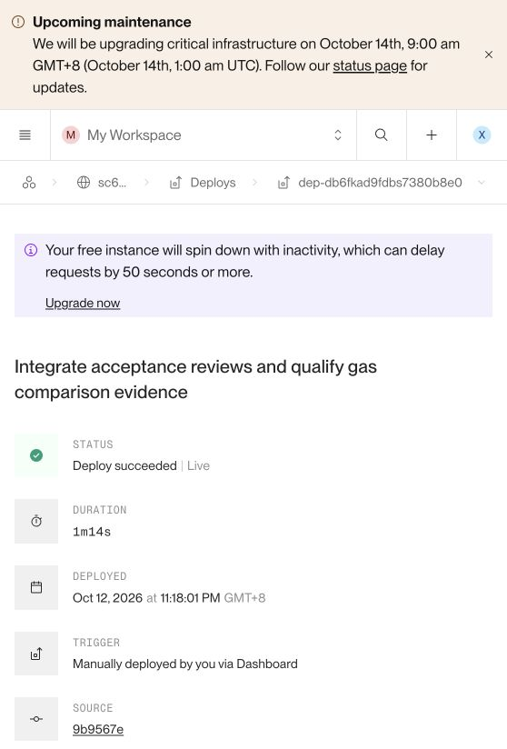

# P5-001 修复上线与复测交接

状态：**已修复、已部署、负责人线上检查通过，等待成员 5 独立复测**。不要据此覆盖历史失败证据或提前将原缺陷关闭。

| 项目 | 记录 |
|---|---|
| 已部署完整 commit SHA | `9b9567e8d2913718bef9607ec6a7a586753c1f14` |
| 代码修复提交 | `2f615e1` |
| Render Deployment ID | `dep-db6fkad9fdbs7380b8e0` |
| Render Service ID | `srv-db5rv4ivcj2c7392k5r0` |
| 部署触发时间 | 2026-10-12 23:18:01，Asia/Singapore（UTC+8） |
| 实际上线完成时间 | **2026-10-12 23:19:16，Asia/Singapore（UTC+8）**；日志 Your service is live |
| 负责人线上检查完成时间 | 2026-10-12 23:20:09，Asia/Singapore（UTC+8） |
| GitHub CI | [run 38269052633](https://github.com/GU-CHE/sc6113-escrow-dapp/actions/runs/38269052633)，编译、11 项合约、9 项 API 测试通过 |
| 负责人线上只读检查 | 21 PASS / 0 FAIL，见 [原始 JSON](review/p5-001-live-verification.json) |
| PR #1 / #2 | 已合并；合并提交分别为 `34a76c2` / `b82971a` |

[Render 部署详情](https://dashboard.render.com/web/srv-db5rv4ivcj2c7392k5r0/deploys/dep-db6fkad9fdbs7380b8e0)（需项目权限） · [部署 commit](https://github.com/GU-CHE/sc6113-escrow-dapp/commit/9b9567e8d2913718bef9607ec6a7a586753c1f14) · [公开应用](https://sc6113-escrow-dapp.onrender.com/)

注意：Render 页面 Deployed 字段显示触发时间，不是服务真正上线时间。保存这些上线证据的后续提交只改文档，线上运行版本仍为上表 SHA。

## 修复行为

错误原因：before 字符串转整数的 ValueError 被统一映射成链上服务故障 503。现在先验证游标格式与范围，再访问 RPC。

- 空、非整数、零、负数、指数/小数、超 uint256 或重复 before 参数返回 JSON HTTP 400。
- 不传 before 或传有效正整数仍返回 200，订单倒序且 ID 严格小于游标；before=1 返回空列表。
- 真正链上/RPC 故障仍返回 503；在本地隔离测试中模拟验证，没有中断共享云端 RPC。
- 负责人另核对 health、配置/地址、事件和两条历史内容的 canonical Keccak，均通过。没有登录、写数据、重启或钱包交易。

## 给成员 5 的独立复测步骤

1. 对线上 `/api/orders?before=invalid` 保存 HTTP 400 和受控 JSON；确认没有 Python 原始转换异常。
2. 验证 `/api/orders`、`?before=6`、`?before=1` 为 200，分别检查倒序、排他游标和空页。
3. 验证空值、0、负数和重复参数返回 400；可参考负责人 21 项检查，但须自己执行并注明环境和时间。
4. 新增修复后结果文件，写入上述 deployed SHA、Render ID 和截图；保留原始 `live-results.json` 及文件哈希清单不变。
5. 更新缺陷状态和最终验收记录：只有自己的复测通过后再写 RETEST PASS / CLOSED。若改动受清单覆盖的成品，生成一份新版清单并保留旧版。

可复制给组员：

> PR #2 已合并。P5-001 已修复并上线。已部署 SHA：9b9567e8d2913718bef9607ec6a7a586753c1f14；Render 部署 ID：dep-db6fkad9fdbs7380b8e0；上线完成时间：2026-10-12 23:19:16（新加坡时间）。CI 11 项合约和 9 项 API 测试通过，负责人线上 21 项只读检查通过。请独立复测非法及正常分页，新增结果并更新缺陷记录；部署截图和原始检查 JSON 在 docs/review/。
