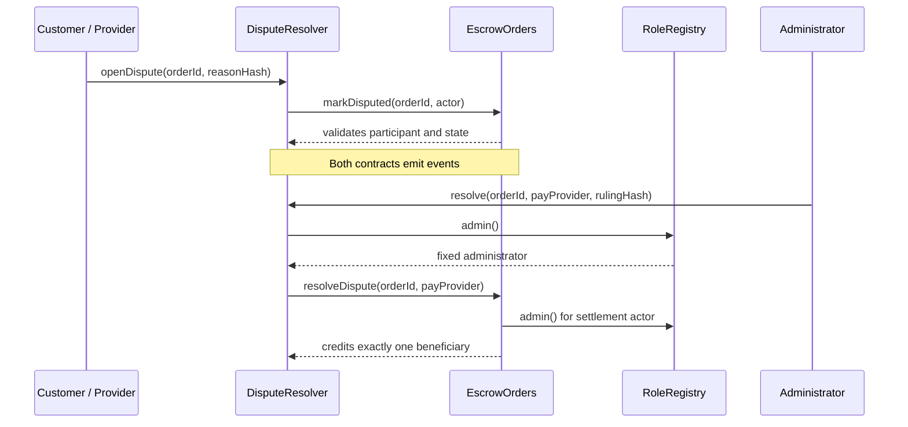

# Part 3: Smart Contract, Permission and Fund Acceptance

Acceptance date: 13 October 2026 (Asia/Shanghai)  
Acceptance baseline: branch `codex/part3-contract-acceptance`, based on main-branch commit `b696822`  
Scope: `RoleRegistry.sol`, `EscrowOrders.sol`, `DisputeResolver.sol`, automated tests, existing Sepolia evidence and gas optimization analysis.

## 1. Conclusion

Fourteen automated tests were executed on a local Ganache network using chain ID 1337 and the Shanghai EVM. The result was **14 passed / 0 failed**. The test suite passed all checks for role boundaries, state transitions, the dispute call chain, exact-value funding, both arbitration outcomes, overdue refunds, duplicate-settlement prevention, rejecting recipients, reentrancy protection and fund conservation across multiple orders. No P0 fund or permission defect, or blocking P1 contract defect, was identified within the tested scope.

Public-chain evidence is reported separately from local results. The three contracts and resolver-binding transaction were deployed to Sepolia, and their creation bytecode matches the repository artifacts. Member 2 recorded 32 real MetaMask business transactions and reconciled both order-level and contract-level funds. See `docs/SEPOLIA_VERIFICATION.json`, `docs/BUSINESS_ACCEPTANCE_ZH.md` and `docs/review/business-chain-review.json`. This report did not re-execute or fabricate those public-chain transactions.

This conclusion shows only that the course prototype satisfies the listed acceptance cases. It is not an independent security audit or a claim of production readiness.

## 2. Three-Contract Interaction and Trust Boundaries



- `RoleRegistry` is the shared authorization root. The administrator is fixed at deployment, and an ordinary wallet may self-register exactly once as either a Customer or Provider.
- `EscrowOrders` is the authoritative source for funds and order state. It reads registered roles when an order is created, accepts only the exact agreed amount and uses a pull-payment design in which funds are recorded in `credits` before the beneficiary withdraws.
- `DisputeResolver` stores dispute and ruling summaries. Participants may open disputes and submit evidence, while only the fixed administrator may issue a ruling. A ruling invokes restricted entry points on `EscrowOrders`.
- `EscrowOrders.setResolver` may be called only once. It verifies that the candidate contract's `orders()` and `registry()` references point back to the same deployment, preventing an unrelated resolver from being bound accidentally.
- The frontend and Flask service are not the on-chain authorization boundary. The contracts still reject unauthorized transactions when the user interface is bypassed.

## 3. Permission Matrix

Legend: ✅ permitted; ❌ rejected by the contract. A condition means that the relevant order-state or identity requirement must also be satisfied.

| Operation | Customer | Assigned Provider | Admin | Unrelated Wallet | Resolver Contract | Key Preconditions |
|---|---:|---:|---:|---:|---:|---|
| `register(Customer)` | ✅ | ✅ | ❌ | ✅ | ❌ | Current role is None |
| `register(Provider)` | ✅ | ✅ | ❌ | ✅ | ❌ | Current role is None |
| `register(Admin)` | ❌ | ❌ | ❌ | ❌ | ❌ | Public registration can never grant Admin |
| `setResolver` | ❌ | ❌ | ✅ | ❌ | ❌ | First call only; target must be correctly bound |
| `createOrder` | ✅ | ❌ | ❌ | ❌ | ❌ | Registered Customer; assigned wallet is a registered Provider |
| `acceptOrder` | ❌ | ✅ | ❌ | ❌ | ❌ | Created and before the deadline |
| `fundOrder` | ✅ | ❌ | ❌ | ❌ | ❌ | Accepted, before the deadline and `msg.value == amount` |
| `submitDelivery` | ❌ | ✅ | ❌ | ❌ | ❌ | Funded, no later than the deadline and nonzero hash |
| `approveDelivery` | ✅ | ❌ | ❌ | ❌ | ❌ | Submitted |
| `cancelOrder` | ✅ | ❌ | ❌ | ❌ | ❌ | Created or Accepted only; a funded order cannot be cancelled |
| `refundExpired` | ✅ | ❌ | ❌ | ❌ | ❌ | Funded and after the deadline |
| `openDispute` | ✅ | ✅ | ❌ | ❌ | ❌ | Order participant; Funded or Submitted; nonzero hash |
| `addEvidence` | ✅ | ✅ | ❌ | ❌ | ❌ | Active dispute and nonzero hash |
| `resolve` | ❌ | ❌ | ✅ | ❌ | ❌ | Active dispute and nonzero ruling hash |
| `markDisputed` | ❌ | ❌ | ❌ | ❌ | ✅ | Resolver-only internal business entry point |
| `resolveDispute` | ❌ | ❌ | ❌ | ❌ | ✅ | Resolver only; order must be Disputed |
| `withdraw` | ✅ | ✅ | ✅* | ❌* | ❌ | Caller has positive credit; `*` every address may withdraw only its own credit |

The administrator cannot create an order on behalf of a Customer, approve a delivery, or withdraw Customer or Provider funds. The administrator's special authority is limited to the initial resolver binding and the final ruling on an active dispute.

## 4. State and Fund Invariants

Valid state paths:

```text
Created -> Accepted -> Funded -> Submitted -> Released
   |          |          |          |
   +----------+          +----------+-> Disputed -> Released / Refunded
      Cancelled          |
                         +-> Refunded (only after missed deadline, no delivery)
```

The following rules must always hold:

1. Each order may enter only one terminal state: `Released`, `Refunded` or `Cancelled`.
2. `fundOrder` accepts only the exact amount agreed for the order, and the same order cannot be funded twice.
3. Funding performs `lockedTotal += amount`. Settlement performs exactly one `lockedTotal -= amount` and one `claimableTotal += amount`.
4. Each settlement increases the credit of exactly one beneficiary: either the Provider is paid or the Customer is refunded, never both.
5. Under normal operation, `address(EscrowOrders).balance == lockedTotal + claimableTotal`. Another contract can force ETH into the contract through `selfdestruct`, so the strict safety invariant is `balance >= liabilities`.
6. Withdrawal clears the caller's credit and decreases `claimableTotal` before calling the external recipient. If the transfer fails, the entire transaction reverts and the credit is preserved.
7. The `withdrawing` lock prevents a recipient contract from withdrawing a second time during its callback.

The multi-order automated case creates two concurrent 0.01 ETH orders. One order is approved and paid to the Provider, while the other is disputed and refunded to the Customer. Before and after settlement, the test reconciles `lockedTotal`, `claimableTotal`, both addresses' `credits` and the actual contract balance. After both parties withdraw, all four liability checks return to zero.

## 5. Automated Test Traceability

| # | Automated Scenario | Main Requirement or Risk | Result |
|---:|---|---|---:|
| 1 | Public registration cannot grant Admin or overwrite an existing role | Privilege escalation and role replacement | ✅ |
| 2 | Resolver may be configured once and only by Admin | Administrative authority and immutable configuration | ✅ |
| 3 | Reject zero administrator, EOA and incorrect Registry/Orders bindings | Misconfiguration or malicious resolver | ✅ |
| 4 | Order creation validates role, amount, deadline and terms hash | Input and identity constraints | ✅ |
| 5 | Successful lifecycle pays exactly once and completes withdrawal | Primary lifecycle and fund conservation | ✅ |
| 6 | Unrelated wallets, wrong amounts and illegal transitions revert | Unauthorized access and state machine | ✅ |
| 7 | Cancellation before funding prevents later acceptance or funding | Terminal-state irreversibility | ✅ |
| 8 | Dispute refund requires Admin, evidence is participant-only and settlement cannot repeat | Arbitration authority | ✅ |
| 9 | A submitted-work dispute can be resolved in favor of the Provider | Second arbitration outcome | ✅ |
| 10 | Nonzero hashes, duplicate disputes and dual-contract events | Evidence integrity and contract interaction | ✅ |
| 11 | Only an overdue, funded and undelivered order can be refunded | Deadline and refund rules | ✅ |
| 12 | A rejecting recipient keeps its credit and reentrancy cannot double-withdraw | External-call safety | ✅ |
| 13 | Two concurrent orders preserve balance and liability accounting | Aggregate accounting correctness | ✅ |
| 14 | Unknown orders and zero-credit withdrawals are rejected; final liabilities are zero | Boundary conditions and final reconciliation | ✅ |

Reproduction command: `pnpm test`. The recorded local environment was Windows, Node 24.12.0, solc 0.8.30, ethers 6.15.0 and Ganache 7.9.2. Because a compatible native µWS module was unavailable, Ganache used its JavaScript fallback. This increased execution time but all 14 tests passed. Node 22 remains the recommended CI environment.

## 6. Sepolia Evidence Review

Deployment addresses:

| Contract | Address |
|---|---|
| RoleRegistry | `0x301B9E840e8FCf727c4b31c9AF75477D64FD4810` |
| EscrowOrders | `0xf56A0BDED64dA25261FE4DAd31a72D521ED0680B` |
| DisputeResolver | `0xA0B660Bb047a7Bebc461630D4c7B3F3072EC25a8` |

`SEPOLIA_VERIFICATION.json` records four successful deployment and binding transactions, each with receipt status 1. The three creation bytecodes match the repository artifacts, and the Registry, Orders and Resolver bindings were verified through read-only RPC calls.

`BUSINESS_ACCEPTANCE_ZH.md` records 32 successful transactions. In particular, the `openDispute` and `resolve` receipts contain logs from both `DisputeResolver` and `EscrowOrders`, demonstrating that these are not three unrelated contracts. Both business contracts also depend on `RoleRegistry`. Cases B01, B03, B04 and B05 cover normal payment, dispute refund, dispute payment and overdue refund respectively, with the final recipient and amount reconciled in each case.

## 7. Gas Optimization Analysis (F8)

The `scripts/gas-analysis.cjs` script compiles and executes the same complete transaction sequence twice in one Ganache/Shanghai environment: once with the optimizer disabled and once with the optimizer enabled at 200 runs. Raw results are stored in `docs/part3/evidence/gas-optimization.json`.

### 7.1 Deployment and Bytecode

| Contract | Runtime Bytes: Unoptimized -> 200 Runs | Deployment Gas: Unoptimized -> 200 Runs | Change |
|---|---:|---:|---:|
| RoleRegistry | 1,414 -> 724 | 393,622 -> 238,495 | -39.4% |
| EscrowOrders | 13,820 -> 6,949 | 3,031,417 -> 1,557,343 | -48.6% |
| DisputeResolver | 4,949 -> 2,408 | 1,134,362 -> 582,350 | -48.7% |

### 7.2 Representative Business Transactions

| Operation | Unoptimized Gas | 200-Runs Gas | Change |
|---|---:|---:|---:|
| `createOrder` | 174,706 | 171,989 | -1.6% |
| `acceptOrder` | 43,995 | 42,802 | -2.7% |
| `fundOrder` | 66,321 | 65,072 | -1.9% |
| `submitDelivery` | 64,702 | 63,213 | -2.3% |
| `openDispute` | 100,154 | 97,717 | -2.4% |
| `addEvidence` | 53,159 | 49,914 | -6.1% |
| `resolve` (pay Provider) | 127,718 | 124,568 | -2.5% |
| `withdraw` | 50,390 | 49,872 | -1.0% |

Conclusion: optimizer 200 provides substantial deployment-cost and bytecode-size savings, while also reducing gas for every representative runtime transaction in this comparison. Retaining the repository's current solc optimizer-200 configuration is therefore evidence-based. Only the compiler optimization setting changed; contract logic remained identical. These are deterministic local comparisons, not Sepolia or mainnet fee quotations. Real wallet EIP-7702 forwarding overhead must be discussed separately from contract-call gas.

Potential future optimizations include custom errors, event redesign and tighter storage packing. They were not adopted in this release because they would change the ABI, bytecode or readability and would require a complete redeployment and regression cycle. Near the submission deadline, reducing gas alone would not justify modifying already validated contracts.

## 8. Security Evaluation

| Risk | Current Control | Residual Risk or Conclusion |
|---|---|---|
| Role escalation | Admin is set only by the constructor; public registration accepts only Customer or Provider | Compromise of the administrator key affects every dispute |
| Incorrect Resolver | Admin-only one-time configuration with bidirectional address-binding checks | The binding cannot be repaired or upgraded; the complete system must be redeployed |
| Duplicate funding or settlement | Strict state machine; settlement enters a terminal state | Covered by positive and negative tests |
| Withdrawal reentrancy | Checks-Effects-Interactions and the global `withdrawing` lock | A malicious recipient may reject payment, but its credit remains available for a later retry |
| Arbitrary-wallet disputes or evidence | Both Resolver and Orders verify participants | Subjective decisions by one Admin remain a centralized trust assumption |
| Fabricated text | Only nonzero Keccak hashes are stored on chain; retrieved off-chain content is rehashed | A hash proves consistency, not truth, and does not guarantee permanent database availability |
| Deadline boundary | Acceptance and funding require `< deadline`; delivery allows `<= deadline`; refund requires `> deadline` | Block timestamps have limited validator tolerance, so the interface should leave a safety margin |
| Forced ETH | Accounting uses independent `lockedTotal` and `claimableTotal` values | Forced extra ETH has no recovery route, so the balance may exceed liabilities |
| Emergency response | Fixed code with no owner withdrawal entry point | No pause, upgrade, appeal or multisignature mechanism; unsuitable for real high-value assets |

## 9. Final Acceptance Sign-Off

- [x] Three roles and the on-chain permission matrix are documented.
- [x] The three contracts have real business calls and shared authorization dependencies.
- [x] Normal payment, dispute refund, dispute payment and overdue refund have automated and Sepolia evidence.
- [x] Duplicate operations, unauthorized access, wrong amounts, illegal states, incorrect bindings and reentrancy have negative tests.
- [x] Multi-order fund liabilities and actual contract balance are automatically reconciled.
- [x] All 14 local contract tests pass.
- [x] Gas optimization has a reproducible before-and-after comparison.
- [x] Trust assumptions, residual risks and non-production limitations are explicitly disclosed.
- [ ] After the branch is pushed, obtain an independent GitHub Actions result for the three added tests.
- [ ] Member 3 must add their real identity, personally review the materials and accurately disclose AI assistance in the individual contribution report.
