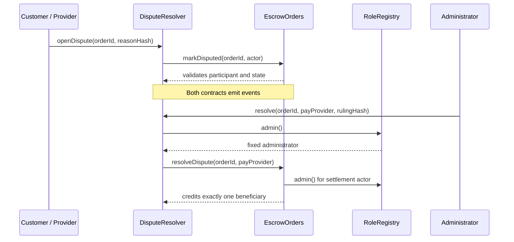

# Part 3：智能合约、权限与资金验收

验收日期：2026-10-13（Asia/Shanghai）  
验收基线：分支 `codex/part3-contract-acceptance`，基于主分支提交 `b696822`  
范围：`RoleRegistry.sol`、`EscrowOrders.sol`、`DisputeResolver.sol`、自动化测试、Sepolia 既有证据和 Gas 优化分析。

## 1. 结论

本次在本地 Ganache（chain ID 1337、Shanghai EVM）运行 14 项自动化测试，结果为 **14 passed / 0 failed**。三合约的角色边界、状态转换、争议调用链、精确入金、两类裁决、超期退款、重复结算防护、拒收款与重入防护、以及多订单资金守恒均通过。测试范围内未发现 P0（资金/权限）或阻塞性 P1 合约缺陷。

公开链证据与本地结果分开表述：三合约和绑定交易已经部署至 Sepolia，创建字节码与仓库产物一致；32 笔真实 MetaMask 业务交易及订单级/合约级资金对账已由成员 2 记录。详见 `docs/SEPOLIA_VERIFICATION.json`、`docs/BUSINESS_ACCEPTANCE_ZH.md` 和 `docs/review/business-chain-review.json`。本报告没有重新执行或伪造这些链上交易。

该结论只说明课程原型满足已列出的验收用例，不等同于第三方安全审计或生产可用性保证。

## 2. 三合约交互与信任边界



- `RoleRegistry` 是共享权限根：部署时固定管理员，普通钱包只能一次性自注册为 Customer 或 Provider。
- `EscrowOrders` 是资金和订单状态的唯一权威来源。它在创建订单时读取注册角色，只接受精确金额，并采用 pull-payment（记入 `credits` 后由收款人主动提现）。
- `DisputeResolver` 保存争议与裁决摘要。参与者可以发起争议和提交证据，只有固定管理员可以裁决；裁决通过受限入口调用 `EscrowOrders`。
- `EscrowOrders.setResolver` 只能调用一次，并验证目标合约的 `orders()` 和 `registry()` 绑定，防止绑定到另一个系统的裁决器。
- 前端与 Flask 不是链上权限边界；即使绕过界面，合约仍会拒绝越权交易。

## 3. 权限矩阵

符号：✅ 允许；❌ 合约拒绝；条件表示还需满足订单状态或身份约束。

| 操作 | Customer | 指定 Provider | Admin | 无关钱包 | Resolver 合约 | 关键前置条件 |
|---|---:|---:|---:|---:|---:|---|
| `register(Customer)` | ✅ | ✅ | ❌ | ✅ | ❌ | 当前角色为 None |
| `register(Provider)` | ✅ | ✅ | ❌ | ✅ | ❌ | 当前角色为 None |
| `register(Admin)` | ❌ | ❌ | ❌ | ❌ | ❌ | 公开注册永远不能授予 Admin |
| `setResolver` | ❌ | ❌ | ✅ | ❌ | ❌ | 仅首次；目标必须是正确绑定的合约 |
| `createOrder` | ✅ | ❌ | ❌ | ❌ | ❌ | 已注册 Customer；指定对象为已注册 Provider |
| `acceptOrder` | ❌ | ✅ | ❌ | ❌ | ❌ | Created 且未到期 |
| `fundOrder` | ✅ | ❌ | ❌ | ❌ | ❌ | Accepted、未到期、`msg.value == amount` |
| `submitDelivery` | ❌ | ✅ | ❌ | ❌ | ❌ | Funded、未超过 deadline、hash 非零 |
| `approveDelivery` | ✅ | ❌ | ❌ | ❌ | ❌ | Submitted |
| `cancelOrder` | ✅ | ❌ | ❌ | ❌ | ❌ | 只能取消 Created / Accepted，不能取消已入金订单 |
| `refundExpired` | ✅ | ❌ | ❌ | ❌ | ❌ | Funded 且已超过 deadline |
| `openDispute` | ✅ | ✅ | ❌ | ❌ | ❌ | 本订单参与者；Funded / Submitted；hash 非零 |
| `addEvidence` | ✅ | ✅ | ❌ | ❌ | ❌ | 活跃争议；hash 非零 |
| `resolve` | ❌ | ❌ | ✅ | ❌ | ❌ | 活跃争议；裁决 hash 非零 |
| `markDisputed` | ❌ | ❌ | ❌ | ❌ | ✅ | Resolver 专用内部业务入口 |
| `resolveDispute` | ❌ | ❌ | ❌ | ❌ | ✅ | Resolver 专用；订单必须为 Disputed |
| `withdraw` | ✅ | ✅ | ✅* | ❌* | ❌ | 调用者有正数 credit；`*`任何地址都只能提取自己的 credit |

管理员不能代替客户创建订单、验收交付或提取客户/服务方余额。管理员的特殊权力仅为首次绑定裁决合约和对活跃争议作最终裁决。

## 4. 状态与资金不变量

合法状态路径：

```text
Created -> Accepted -> Funded -> Submitted -> Released
   |          |          |          |
   +----------+          +----------+-> Disputed -> Released / Refunded
      Cancelled          |
                         +-> Refunded (only after missed deadline, no delivery)
```

必须始终成立的规则：

1. 每个订单只能进入一个终态：`Released`、`Refunded` 或 `Cancelled`。
2. `fundOrder` 只接收订单约定的精确金额，且同一订单不能重复入金。
3. 入金时 `lockedTotal += amount`；结算时只执行一次 `lockedTotal -= amount`、`claimableTotal += amount`。
4. 每次结算只给一方增加 credit：付款给 Provider 或退款给 Customer，不会同时发生。
5. 正常情况下 `address(EscrowOrders).balance == lockedTotal + claimableTotal`。其他合约用 `selfdestruct` 强制发送 ETH 时，余额可以大于负债总额，所以安全不变量采用 `balance >= liabilities`。
6. 提现先把调用者的 credit 清零并减少 `claimableTotal`，再调用外部地址；失败则整笔交易回滚，credit 保留。
7. `withdrawing` 锁阻止收款合约在回调中重复提现。

多订单自动化用例同时创建两笔 0.01 ETH 订单：一笔正常付款给 Provider，另一笔争议退款给 Customer。结算前后分别核对 `lockedTotal`、`claimableTotal`、两个地址的 `credits` 和合约实际余额；两方提现后四项负债均归零。

## 5. 自动化测试追踪

| # | 自动化场景 | 主要要求/风险 | 结果 |
|---:|---|---|---:|
| 1 | 禁止自注册 Admin 与重复注册 | 角色升级、角色覆盖 | ✅ |
| 2 | Resolver 只能由 Admin 绑定一次 | 管理权限、配置不可变 | ✅ |
| 3 | 拒绝零管理员、EOA、错误 Registry/Orders 绑定 | 错配或恶意裁决器 | ✅ |
| 4 | 创建订单校验角色、金额、期限、条款 hash | 输入与身份约束 | ✅ |
| 5 | 正常流程只支付一次并完成提现 | 主流程、资金守恒 | ✅ |
| 6 | 无关钱包、错误金额、非法状态转换均回退 | 越权与状态机 | ✅ |
| 7 | 未入金取消后不能再接单或入金 | 终态不可逆 | ✅ |
| 8 | 争议退款需 Admin，证据限参与者，不能重复裁决 | 仲裁权限 | ✅ |
| 9 | 已交付争议可裁决支付 Provider | 第二种裁决结果 | ✅ |
| 10 | 非零 hash、重复争议、双合约事件 | 证据完整性、合约交互 | ✅ |
| 11 | 只有超期且未交付的 Funded 订单可退款 | 截止时间与退款 | ✅ |
| 12 | 拒收款保留 credit；重入不能重复提现 | 外部调用安全 | ✅ |
| 13 | 两笔并行订单的余额和负债守恒 | 聚合会计正确性 | ✅ |
| 14 | 不存在订单和零余额提现被拒绝；最终负债为零 | 边界与清算 | ✅ |

复现命令：`pnpm test`。本次实际运行环境为 Windows、Node 24.12.0、solc 0.8.30、ethers 6.15.0、Ganache 7.9.2；Ganache 因无对应的原生 µWS 模块使用 JavaScript 回退实现，测试耗时增加但 14 项全部通过。CI 推荐 Node 22。

## 6. Sepolia 证据核对

部署地址：

| 合约 | 地址 |
|---|---|
| RoleRegistry | `0x301B9E840e8FCf727c4b31c9AF75477D64FD4810` |
| EscrowOrders | `0xf56A0BDED64dA25261FE4DAd31a72D521ED0680B` |
| DisputeResolver | `0xA0B660Bb047a7Bebc461630D4c7B3F3072EC25a8` |

`SEPOLIA_VERIFICATION.json` 记录的四笔部署/绑定交易均为 status 1，三个 creation bytecode 与仓库产物一致，且 Registry、Orders、Resolver 的绑定关系通过只读 RPC 核验。

`BUSINESS_ACCEPTANCE_ZH.md` 记录 32 笔成功交易。特别是 `openDispute` 和 `resolve` 的 receipt 同时包含 `DisputeResolver` 与 `EscrowOrders` 日志，证明并非三个互不相关的合约；两个业务合约又共同依赖 `RoleRegistry`。B01、B03、B04、B05 分别覆盖正常支付、争议退款、争议付款和超期退款，最终收款人和金额均完成对账。

## 7. Gas 优化分析（F8）

脚本 `scripts/gas-analysis.cjs` 在同一 Ganache/Shanghai 环境分别编译并运行 optimizer disabled 与 optimizer enabled / 200 runs 两组完整交易。原始结果保存在 `docs/part3/evidence/gas-optimization.json`。

### 7.1 部署与字节码

| 合约 | Runtime bytes：未优化 → 200 runs | 部署 gas：未优化 → 200 runs | 变化 |
|---|---:|---:|---:|
| RoleRegistry | 1,414 → 724 | 393,622 → 238,495 | −39.4% |
| EscrowOrders | 13,820 → 6,949 | 3,031,417 → 1,557,343 | −48.6% |
| DisputeResolver | 4,949 → 2,408 | 1,134,362 → 582,350 | −48.7% |

### 7.2 代表性业务交易

| 操作 | 未优化 gas | 200 runs gas | 变化 |
|---|---:|---:|---:|
| `createOrder` | 174,706 | 171,989 | −1.6% |
| `acceptOrder` | 43,995 | 42,802 | −2.7% |
| `fundOrder` | 66,321 | 65,072 | −1.9% |
| `submitDelivery` | 64,702 | 63,213 | −2.3% |
| `openDispute` | 100,154 | 97,717 | −2.4% |
| `addEvidence` | 53,159 | 49,914 | −6.1% |
| `resolve`（支付 Provider） | 127,718 | 124,568 | −2.5% |
| `withdraw` | 50,390 | 49,872 | −1.0% |

结论：optimizer 200 对部署成本和字节码大小的收益显著，对本组代表性运行交易也全部降低 gas，因此保留当前 solc optimizer 200 配置是有依据的选择。此对照只改变编译器优化配置，没有改变合约逻辑。它是本地确定性比较，不是 Sepolia 或主网的费用报价；真实钱包的 EIP-7702 转发开销须与合约调用 gas 分开讨论。

后续可评估但本次没有采用的优化包括自定义错误、事件拆分或更紧凑的存储布局。它们会改变 ABI、字节码或可读性，并要求重新部署和完整回归；临近提交时不应仅为追求更低 gas 冒险修改已验证合约。

## 8. 安全评估

| 风险 | 当前控制 | 剩余风险/结论 |
|---|---|---|
| 角色升级 | Admin 仅在构造函数设置；公开注册只接受 Customer/Provider | 管理员私钥泄露会影响全部争议 |
| 错误 Resolver | Admin-only、一次性设置、双向地址绑定检查 | 绑定后不能修复或升级，只能整体重新部署 |
| 重复入金/结算 | 严格状态机，结算后进入终态 | 已覆盖正反测试 |
| 重入提现 | Checks-Effects-Interactions + `withdrawing` 全局锁 | 恶意收款合约可拒收，但 credit 保留，可稍后重试 |
| 任意钱包争议/举证 | Resolver 和 Orders 都检查参与者 | 单一 Admin 的主观裁决仍是中心化信任点 |
| 伪造文本 | 链上只保存非零 Keccak hash，链下读取时再校验 | Hash 只证明内容一致，不证明内容真实，也不保证数据库永久可用 |
| 时间边界 | 接单/入金要求 `< deadline`；交付允许 `<= deadline`；退款要求 `> deadline` | 区块时间有小幅验证者容差，界面应留出余量 |
| 强制 ETH | 会计使用独立 `lockedTotal`/`claimableTotal` | 被强制发送的额外 ETH 没有回收入口，故余额可能大于负债 |
| 紧急响应 | 固定代码、无 owner 提现入口 | 没有暂停、升级、申诉或多签机制，不适合真实大额资产 |

## 9. 最终验收签署项

- [x] 三种角色及链上权限矩阵完成。
- [x] 三个合约存在实际业务调用与共享权限依赖。
- [x] 正常付款、争议退款、争议付款、超期退款均有自动化和 Sepolia 证据。
- [x] 重复操作、越权、错误金额、非法状态、错误绑定、重入均有反向测试。
- [x] 多订单资金负债与实际余额完成自动化对账。
- [x] 14 项本地合约测试全部通过。
- [x] Gas 优化有可复现的优化前后对照。
- [x] 信任假设、剩余风险和非生产级范围已明确披露。
- [ ] 推送分支后等待 GitHub Actions 对新增 14 项测试给出独立 CI 结果。
- [ ] 成员 3 填写真实姓名，亲自复核材料并在个人贡献报告中如实披露 AI 协助。
